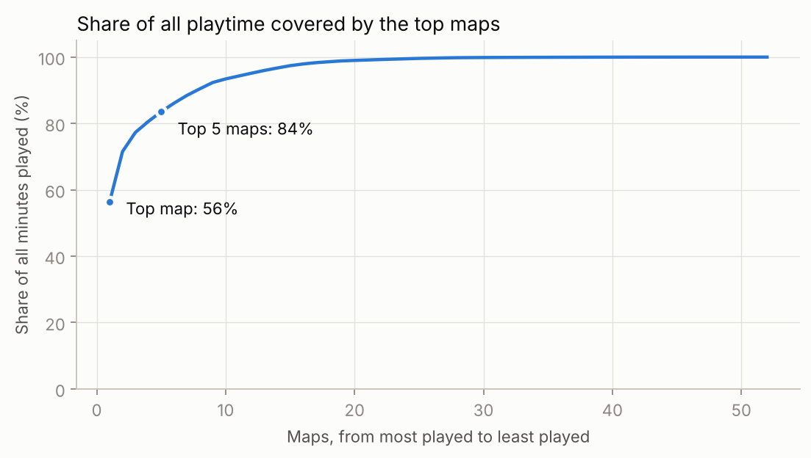
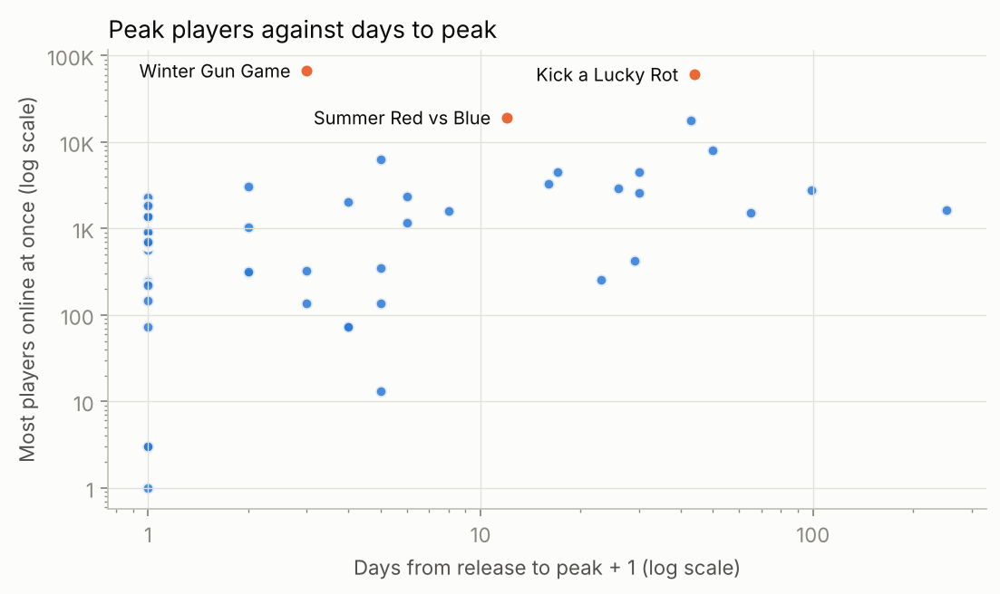
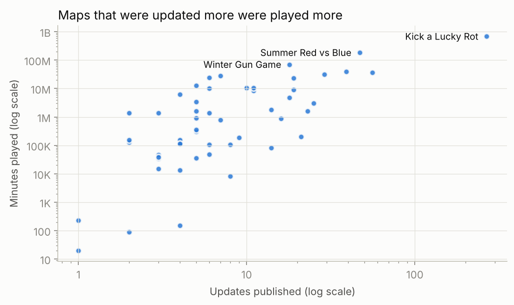
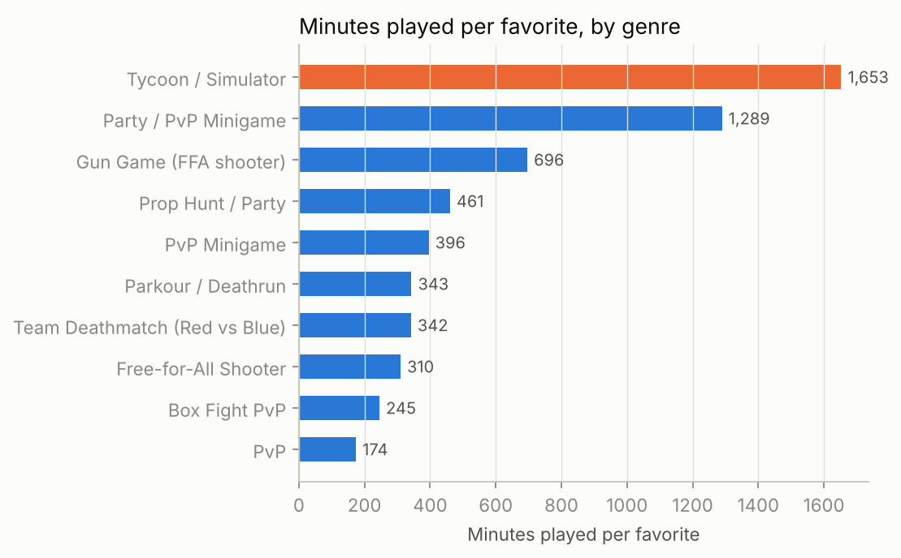

# Fortnite maps analytics

I have published 52 maps in Fortnite (an online game where players can also build their own game modes and share them with everyone). Together they have been played for about 1.2 billion minutes. Most of that came from just a few maps, so I collected the public stats for all 52 and looked for what the successful ones had in common.

The full analysis with code is in [`analysis.ipynb`](analysis.ipynb), and the dataset is in [`data/maps.csv`](data/maps.csv).

## Findings

**1. A few maps did almost all of the work.** Kick a Lucky Rot alone has 56% of all minutes played on my maps, the top five have 84%, and the 26 least played maps together have 0.3%.



**2. Most maps peak in the first days, the biggest ones keep growing.** Half of the maps reached their record within two days of release. Kick a Lucky Rot peaked 43 days after release and Escape Prison for Brainrots after 42.



**3. Updates and playtime go together.** Spearman correlation between the number of updates and minutes played is 0.68. The median map with 15 or more updates has about 23 million minutes, the median map with fewer updates has about 160 thousand. Causality runs both ways here (I update the maps people already play), but none of the big maps got there without constant work after release.



**4. Tycoon maps keep players much longer.** On tycoon and simulator maps each favorite comes with about 1,650 minutes played, on team deathmatch maps about 340. My two tycoon maps, both from 2026, have 59% of all my minutes.



**5. Seasonal maps peaked higher.** Maps with a holiday or season in the name had a median peak of about 2,300 players at once, against 824 for the rest. There are only 10 of them, so I treat this as something to test, not a rule.

## Data

One row per map, sorted by release date. Stats are from [fortnite.gg](https://fortnite.gg), pulled on October 17, 2026. They are lifetime totals for each map, with nothing about individual players.

| Column | Meaning |
|---|---|
| `release_date` | Date the map was first published |
| `map_name`, `island_code` | Map title and its code in Fortnite |
| `genre` | Genre I assigned from the map's Fortnite tags |
| `peak_players`, `peak_date` | Most players online at once, and when it happened |
| `days_to_peak` | Days between release and the peak |
| `minutes_played`, `favorites` | Lifetime minutes played and number of favorites |
| `max_players` | Player limit per match |
| `updates_published`, `last_updated` | Number of published versions and the date of the latest one |
| `status` | `Live` or `Disabled` (no longer playable) |
| `studio_account` | Account the map was published under. I worked in several game studios and founded my own, and each map went out under the account of the studio it was made in |
| `tags` | The map's Fortnite tags |

## Run it

```bash
pip install -r requirements.txt
jupyter notebook analysis.ipynb
```
